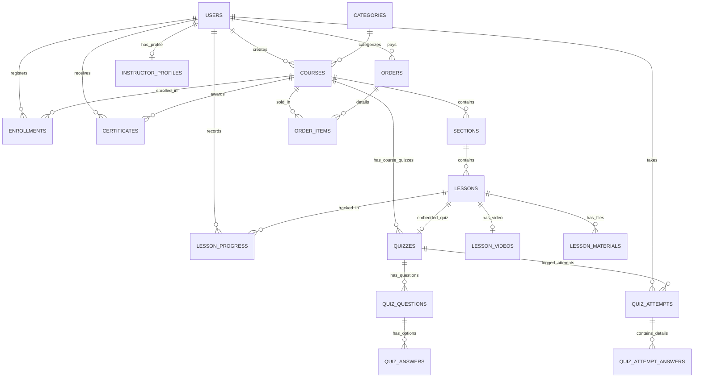

# 🎓 E-Learning Management System (LMS) — Roadmap & Database Architecture

> **Dự án**: Hệ thống Quản lý & Học tập Trực tuyến (LMS)  
> **Phiên bản tài liệu**: `v1.0.0`  
> **Trạng thái**: Lập kế hoạch & Thiết kế CSDL

---

## 📑 Mục lục
1. [Tổng quan dự án & Yêu cầu](#1-tổng-quan-dự-án--yêu-cầu)
2. [Thiết kế Cơ sở Dữ liệu (Database Schema)](#2-thiết-kế-cơ-sở-dữ-liệu-database-schema)
   - [2.1 Sơ đồ thực thể ERD](#21-sơ-đồ-thực-thể-erd)
   - [2.2 Kịch bản DDL SQL hoàn chỉnh](#22-kịch-bản-ddl-sql-hoàn-chỉnh)
3. [Lộ trình phát triển chi tiết (Roadmap theo giai đoạn)](#3-lộ-trình-phát-triển-chi-tiết-roadmap)
   - [Giai đoạn 1: Khởi tạo CSDL, Cấu trúc dự án & Auth/RBAC](#giai-đoạn-1-khởi-tạo-csdl-cấu-trúc-dự-án--authrbac)
   - [Giai đoạn 2: Quản trị Khóa học & Nội dung học](#giai-đoạn-2-quản-trị-khóa-học--nội-dung-học)
   - [Giai đoạn 3: Phân hệ Học viên (Catalog) & Cổng thanh toán](#giai-đoạn-3-phân-hệ-học-viên-catalog--cổng-thanh-toán)
   - [Giai đoạn 4: Phòng học trực tuyến (LMS Player) & Lưu tiến độ](#giai-đoạn-4-phòng-học-trực-tuyến-lms-player--lưu-tiến-độ)
   - [Giai đoạn 5: Hệ thống Bài kiểm tra & Chấm điểm tự động (Quiz Engine)](#giai-đoạn-5-hệ-thống-bài-kiểm-tra--chấm-điểm-tự-động-quiz-engine)
   - [Giai đoạn 6: Cấp phát Chứng chỉ tự động & Xác thực QR](#giai-đoạn-6-cấp-phát-chứng-chỉ-tự-động--xác-thực-qr)
   - [Giai đoạn 7: Dashboard Báo cáo Thống kê & Phân tích](#giai-đoạn-7-dashboard-báo-cáo-thống-kê--phân-tích)
   - [Giai đoạn 8: Bảo mật, Kiểm thử & Đóng gói triển khai](#giai-đoạn-8-bảo-mật-kiểm-thử--đóng-gói-triển-khai)
4. [Checklist Tính năng theo Vai trò (User Stories)](#4-checklist-tính-năng-theo-vai-trò)
5. [Khuyến nghị Kỹ thuật & Bảo mật](#5-khuyến-nghị-kỹ-thuật--bảo-mật)

---

## 1. Tổng quan dự án & Yêu cầu

### 1.1 Phân quyền & Vai trò người dùng
Hệ thống hỗ trợ 3 nhóm đối tượng:
1. **Học viên (Student / Learner)**:
   - Đăng ký, đăng nhập tài khoản.
   - Tìm kiếm, xem danh sách, lọc khóa học theo danh mục, giá, trình độ.
   - Xem chi tiết nội dung, học thử bài xem trước (`is_preview`).
   - Đăng ký khóa học và thanh toán trực tuyến (VNPay, MoMo, VietQR, Khóa học miễn phí).
   - Tham gia phòng học: Xem video streaming, tải tài liệu đính kèm (PDF, Slide, Code).
   - Theo dõi tiến độ học tập (% hoàn thành, đánh dấu bài đã học).
   - Làm bài kiểm tra (Quiz đếm ngược thời gian), xem điểm số và xem lại lời giải thích.
   - Nhận chứng chỉ hoàn thành khóa học (tải PDF và có mã QR xác thực).
2. **Giảng viên (Instructor)**:
   - Quản lý hồ sơ giảng viên (chức danh, tiểu sử, bằng cấp, kinh nghiệm).
   - Xây dựng giáo trình: Tạo khóa học, phân chia chương/bài học, upload video bài giảng, upload tài liệu.
   - Soạn thảo ngân hàng câu hỏi, tạo bài kiểm tra trắc nghiệm, cấu hình điểm đạt.
   - Theo dõi danh sách học viên tham gia khóa học và kết quả kiểm tra.
3. **Quản trị viên (Admin)**:
   - Quản trị toàn bộ người dùng (học viên, giảng viên, phân quyền, khóa/mở tài khoản).
   - Quản lý danh mục, khóa học (duyệt khóa học, đổi trạng thái công khai).
   - Quản trị nội dung: Chương, bài học, video, tài liệu.
   - Quản trị bài kiểm tra, câu hỏi, đáp án, lượt nộp bài của học viên.
   - Quản lý mẫu chứng chỉ, cấp phát / thu hồi chứng chỉ.
   - Thống kê toàn diện: Tăng trưởng học viên, tỷ lệ hoàn thành, doanh thu khóa học theo thời gian.

---

## 2. Thiết kế Cơ sở Dữ liệu (Database Schema)

### 2.1 Sơ đồ thực thể ERD



---

### 2.2 Kịch bản DDL SQL hoàn chỉnh

Chạy trực tiếp trên MySQL 8.0+ / MariaDB 10.4+:

```sql
SET FOREIGN_KEY_CHECKS = 0;
DROP TABLE IF EXISTS certificates;
DROP TABLE IF EXISTS quiz_attempt_answers;
DROP TABLE IF EXISTS quiz_attempts;
DROP TABLE IF EXISTS quiz_answers;
DROP TABLE IF EXISTS quiz_questions;
DROP TABLE IF EXISTS quizzes;
DROP TABLE IF EXISTS lesson_progress;
DROP TABLE IF EXISTS order_items;
DROP TABLE IF EXISTS orders;
DROP TABLE IF EXISTS enrollments;
DROP TABLE IF EXISTS lesson_materials;
DROP TABLE IF EXISTS lesson_videos;
DROP TABLE IF EXISTS lessons;
DROP TABLE IF EXISTS sections;
DROP TABLE IF EXISTS courses;
DROP TABLE IF EXISTS categories;
DROP TABLE IF EXISTS instructor_profiles;
DROP TABLE IF EXISTS users;
SET FOREIGN_KEY_CHECKS = 1;

-- -------------------------------------------------------------
-- 1. BẢNG NGƯỜI DÙNG & TÀI KHOẢN (Users)
-- -------------------------------------------------------------
CREATE TABLE users (
    id INT UNSIGNED AUTO_INCREMENT PRIMARY KEY,
    name VARCHAR(150) NOT NULL,
    email VARCHAR(191) NOT NULL UNIQUE,
    password VARCHAR(255) NOT NULL,
    phone VARCHAR(20) NULL,
    avatar VARCHAR(255) NULL,
    role ENUM('student', 'instructor', 'admin') NOT NULL DEFAULT 'student',
    status ENUM('active', 'inactive', 'banned') NOT NULL DEFAULT 'active',
    email_verified_at TIMESTAMP NULL,
    created_at TIMESTAMP DEFAULT CURRENT_TIMESTAMP,
    updated_at TIMESTAMP DEFAULT CURRENT_TIMESTAMP ON UPDATE CURRENT_TIMESTAMP,
    INDEX idx_user_role (role),
    INDEX idx_user_status (status)
) ENGINE=InnoDB DEFAULT CHARSET=utf8mb4 COLLATE=utf8mb4_unicode_ci;

-- -------------------------------------------------------------
-- 2. BẢNG HỒ SƠ GIẢNG VIÊN (Instructor Profiles)
-- -------------------------------------------------------------
CREATE TABLE instructor_profiles (
    id INT UNSIGNED AUTO_INCREMENT PRIMARY KEY,
    user_id INT UNSIGNED NOT NULL UNIQUE,
    headline VARCHAR(255) NULL COMMENT 'Chức danh / Tiêu đề chuyên môn',
    bio TEXT NULL COMMENT 'Giới thiệu bản thân',
    qualification VARCHAR(255) NULL COMMENT 'Học vị / Bằng cấp',
    experience_years TINYINT UNSIGNED DEFAULT 0,
    created_at TIMESTAMP DEFAULT CURRENT_TIMESTAMP,
    FOREIGN KEY (user_id) REFERENCES users(id) ON DELETE CASCADE
) ENGINE=InnoDB DEFAULT CHARSET=utf8mb4 COLLATE=utf8mb4_unicode_ci;

-- -------------------------------------------------------------
-- 3. BẢNG DANH MỤC KHÓA HỌC (Categories)
-- -------------------------------------------------------------
CREATE TABLE categories (
    id INT UNSIGNED AUTO_INCREMENT PRIMARY KEY,
    parent_id INT UNSIGNED NULL,
    name VARCHAR(150) NOT NULL,
    slug VARCHAR(191) NOT NULL UNIQUE,
    description VARCHAR(255) NULL,
    sort_order INT DEFAULT 0,
    is_active BOOLEAN DEFAULT TRUE,
    created_at TIMESTAMP DEFAULT CURRENT_TIMESTAMP,
    FOREIGN KEY (parent_id) REFERENCES categories(id) ON DELETE SET NULL
) ENGINE=InnoDB DEFAULT CHARSET=utf8mb4 COLLATE=utf8mb4_unicode_ci;

-- -------------------------------------------------------------
-- 4. BẢNG KHÓA HỌC (Courses)
-- -------------------------------------------------------------
CREATE TABLE courses (
    id INT UNSIGNED AUTO_INCREMENT PRIMARY KEY,
    instructor_id INT UNSIGNED NOT NULL,
    category_id INT UNSIGNED NULL,
    title VARCHAR(255) NOT NULL,
    slug VARCHAR(191) NOT NULL UNIQUE,
    summary VARCHAR(500) NULL,
    description LONGTEXT NULL,
    thumbnail VARCHAR(255) NULL,
    price DECIMAL(12, 2) NOT NULL DEFAULT 0.00,
    sale_price DECIMAL(12, 2) NULL,
    level ENUM('all', 'beginner', 'intermediate', 'advanced') DEFAULT 'all',
    status ENUM('draft', 'published', 'archived') DEFAULT 'draft',
    total_duration_minutes INT UNSIGNED DEFAULT 0,
    total_lessons INT UNSIGNED DEFAULT 0,
    created_at TIMESTAMP DEFAULT CURRENT_TIMESTAMP,
    updated_at TIMESTAMP DEFAULT CURRENT_TIMESTAMP ON UPDATE CURRENT_TIMESTAMP,
    FOREIGN KEY (instructor_id) REFERENCES users(id) ON DELETE RESTRICT,
    FOREIGN KEY (category_id) REFERENCES categories(id) ON DELETE SET NULL,
    INDEX idx_course_status (status),
    INDEX idx_course_price (price, sale_price)
) ENGINE=InnoDB DEFAULT CHARSET=utf8mb4 COLLATE=utf8mb4_unicode_ci;

-- -------------------------------------------------------------
-- 5. BẢNG CHƯƠNG / HỌC PHẦN (Sections)
-- -------------------------------------------------------------
CREATE TABLE sections (
    id INT UNSIGNED AUTO_INCREMENT PRIMARY KEY,
    course_id INT UNSIGNED NOT NULL,
    title VARCHAR(255) NOT NULL,
    sort_order INT UNSIGNED NOT NULL DEFAULT 0,
    created_at TIMESTAMP DEFAULT CURRENT_TIMESTAMP,
    FOREIGN KEY (course_id) REFERENCES courses(id) ON DELETE CASCADE,
    INDEX idx_section_sort (course_id, sort_order)
) ENGINE=InnoDB DEFAULT CHARSET=utf8mb4 COLLATE=utf8mb4_unicode_ci;

-- -------------------------------------------------------------
-- 6. BẢNG BÀI HỌC (Lessons)
-- -------------------------------------------------------------
CREATE TABLE lessons (
    id INT UNSIGNED AUTO_INCREMENT PRIMARY KEY,
    section_id INT UNSIGNED NOT NULL,
    title VARCHAR(255) NOT NULL,
    slug VARCHAR(191) NULL,
    lesson_type ENUM('video', 'document', 'quiz') NOT NULL DEFAULT 'video',
    content LONGTEXT NULL COMMENT 'Nội dung bài viết / bài đọc',
    is_preview BOOLEAN DEFAULT FALSE COMMENT 'Cho phép xem thử miễn phí',
    sort_order INT UNSIGNED NOT NULL DEFAULT 0,
    created_at TIMESTAMP DEFAULT CURRENT_TIMESTAMP,
    FOREIGN KEY (section_id) REFERENCES sections(id) ON DELETE CASCADE,
    INDEX idx_lesson_sort (section_id, sort_order)
) ENGINE=InnoDB DEFAULT CHARSET=utf8mb4 COLLATE=utf8mb4_unicode_ci;

-- -------------------------------------------------------------
-- 7. BẢNG VIDEO BÀI HỌC (Lesson Videos)
-- -------------------------------------------------------------
CREATE TABLE lesson_videos (
    id INT UNSIGNED AUTO_INCREMENT PRIMARY KEY,
    lesson_id INT UNSIGNED NOT NULL UNIQUE,
    provider ENUM('local', 'youtube', 'vimeo', 's3') DEFAULT 'local',
    video_url VARCHAR(500) NOT NULL,
    duration_seconds INT UNSIGNED NOT NULL DEFAULT 0,
    created_at TIMESTAMP DEFAULT CURRENT_TIMESTAMP,
    FOREIGN KEY (lesson_id) REFERENCES lessons(id) ON DELETE CASCADE
) ENGINE=InnoDB DEFAULT CHARSET=utf8mb4 COLLATE=utf8mb4_unicode_ci;

-- -------------------------------------------------------------
-- 8. BẢNG TÀI LIỆU ĐÍNH KÈM (Lesson Materials)
-- -------------------------------------------------------------
CREATE TABLE lesson_materials (
    id INT UNSIGNED AUTO_INCREMENT PRIMARY KEY,
    lesson_id INT UNSIGNED NOT NULL,
    title VARCHAR(255) NOT NULL,
    file_path VARCHAR(500) NOT NULL,
    file_type VARCHAR(50) NULL,
    file_size_bytes BIGINT UNSIGNED DEFAULT 0,
    download_count INT UNSIGNED DEFAULT 0,
    created_at TIMESTAMP DEFAULT CURRENT_TIMESTAMP,
    FOREIGN KEY (lesson_id) REFERENCES lessons(id) ON DELETE CASCADE
) ENGINE=InnoDB DEFAULT CHARSET=utf8mb4 COLLATE=utf8mb4_unicode_ci;

-- -------------------------------------------------------------
-- 9. BẢNG ĐƠN HÀNG MUA KHÓA HỌC (Orders)
-- -------------------------------------------------------------
CREATE TABLE orders (
    id INT UNSIGNED AUTO_INCREMENT PRIMARY KEY,
    user_id INT UNSIGNED NOT NULL,
    order_code VARCHAR(50) NOT NULL UNIQUE,
    total_amount DECIMAL(12, 2) NOT NULL DEFAULT 0.00,
    payment_method ENUM('free', 'vnpay', 'momo', 'vietqr', 'manual') NOT NULL,
    payment_status ENUM('pending', 'completed', 'failed', 'refunded') NOT NULL DEFAULT 'pending',
    transaction_id VARCHAR(100) NULL,
    paid_at TIMESTAMP NULL,
    created_at TIMESTAMP DEFAULT CURRENT_TIMESTAMP,
    FOREIGN KEY (user_id) REFERENCES users(id) ON DELETE RESTRICT,
    INDEX idx_order_status (payment_status),
    INDEX idx_order_code (order_code)
) ENGINE=InnoDB DEFAULT CHARSET=utf8mb4 COLLATE=utf8mb4_unicode_ci;

CREATE TABLE order_items (
    id INT UNSIGNED AUTO_INCREMENT PRIMARY KEY,
    order_id INT UNSIGNED NOT NULL,
    course_id INT UNSIGNED NOT NULL,
    price DECIMAL(12, 2) NOT NULL,
    FOREIGN KEY (order_id) REFERENCES orders(id) ON DELETE CASCADE,
    FOREIGN KEY (course_id) REFERENCES courses(id) ON DELETE RESTRICT
) ENGINE=InnoDB DEFAULT CHARSET=utf8mb4 COLLATE=utf8mb4_unicode_ci;

-- -------------------------------------------------------------
-- 10. BẢNG GHI DANH KHÓA HỌC (Enrollments)
-- -------------------------------------------------------------
CREATE TABLE enrollments (
    id INT UNSIGNED AUTO_INCREMENT PRIMARY KEY,
    user_id INT UNSIGNED NOT NULL,
    course_id INT UNSIGNED NOT NULL,
    status ENUM('active', 'expired', 'revoked') NOT NULL DEFAULT 'active',
    progress_percent DECIMAL(5, 2) NOT NULL DEFAULT 0.00,
    enrolled_at TIMESTAMP DEFAULT CURRENT_TIMESTAMP,
    completed_at TIMESTAMP NULL,
    UNIQUE KEY uq_user_course (user_id, course_id),
    FOREIGN KEY (user_id) REFERENCES users(id) ON DELETE CASCADE,
    FOREIGN KEY (course_id) REFERENCES courses(id) ON DELETE CASCADE,
    INDEX idx_enroll_user (user_id)
) ENGINE=InnoDB DEFAULT CHARSET=utf8mb4 COLLATE=utf8mb4_unicode_ci;

-- -------------------------------------------------------------
-- 11. BẢNG TIẾN ĐỘ TỪNG BÀI HỌC (Lesson Progress)
-- -------------------------------------------------------------
CREATE TABLE lesson_progress (
    id INT UNSIGNED AUTO_INCREMENT PRIMARY KEY,
    user_id INT UNSIGNED NOT NULL,
    lesson_id INT UNSIGNED NOT NULL,
    is_completed BOOLEAN NOT NULL DEFAULT FALSE,
    last_watch_second INT UNSIGNED NOT NULL DEFAULT 0,
    completed_at TIMESTAMP NULL,
    updated_at TIMESTAMP DEFAULT CURRENT_TIMESTAMP ON UPDATE CURRENT_TIMESTAMP,
    UNIQUE KEY uq_user_lesson (user_id, lesson_id),
    FOREIGN KEY (user_id) REFERENCES users(id) ON DELETE CASCADE,
    FOREIGN KEY (lesson_id) REFERENCES lessons(id) ON DELETE CASCADE
) ENGINE=InnoDB DEFAULT CHARSET=utf8mb4 COLLATE=utf8mb4_unicode_ci;

-- -------------------------------------------------------------
-- 12. BẢNG BÀI KIỂM TRA (Quizzes)
-- -------------------------------------------------------------
CREATE TABLE quizzes (
    id INT UNSIGNED AUTO_INCREMENT PRIMARY KEY,
    course_id INT UNSIGNED NOT NULL,
    lesson_id INT UNSIGNED NULL UNIQUE,
    title VARCHAR(255) NOT NULL,
    description TEXT NULL,
    duration_minutes INT UNSIGNED NOT NULL DEFAULT 15,
    passing_score DECIMAL(5, 2) NOT NULL DEFAULT 80.00,
    max_attempts TINYINT UNSIGNED NOT NULL DEFAULT 0,
    is_random_questions BOOLEAN DEFAULT FALSE,
    created_at TIMESTAMP DEFAULT CURRENT_TIMESTAMP,
    FOREIGN KEY (course_id) REFERENCES courses(id) ON DELETE CASCADE,
    FOREIGN KEY (lesson_id) REFERENCES lessons(id) ON DELETE CASCADE
) ENGINE=InnoDB DEFAULT CHARSET=utf8mb4 COLLATE=utf8mb4_unicode_ci;

-- -------------------------------------------------------------
-- 13. BẢNG CÂU HỎI (Quiz Questions)
-- -------------------------------------------------------------
CREATE TABLE quiz_questions (
    id INT UNSIGNED AUTO_INCREMENT PRIMARY KEY,
    quiz_id INT UNSIGNED NOT NULL,
    question_text TEXT NOT NULL,
    question_type ENUM('single_choice', 'multiple_choice', 'true_false') NOT NULL DEFAULT 'single_choice',
    points DECIMAL(5, 2) NOT NULL DEFAULT 1.00,
    explanation TEXT NULL,
    sort_order INT UNSIGNED NOT NULL DEFAULT 0,
    created_at TIMESTAMP DEFAULT CURRENT_TIMESTAMP,
    FOREIGN KEY (quiz_id) REFERENCES quizzes(id) ON DELETE CASCADE
) ENGINE=InnoDB DEFAULT CHARSET=utf8mb4 COLLATE=utf8mb4_unicode_ci;

-- -------------------------------------------------------------
-- 14. BẢNG ĐÁP ÁN (Quiz Answers)
-- -------------------------------------------------------------
CREATE TABLE quiz_answers (
    id INT UNSIGNED AUTO_INCREMENT PRIMARY KEY,
    question_id INT UNSIGNED NOT NULL,
    answer_text TEXT NOT NULL,
    is_correct BOOLEAN NOT NULL DEFAULT FALSE,
    created_at TIMESTAMP DEFAULT CURRENT_TIMESTAMP,
    FOREIGN KEY (question_id) REFERENCES quiz_questions(id) ON DELETE CASCADE
) ENGINE=InnoDB DEFAULT CHARSET=utf8mb4 COLLATE=utf8mb4_unicode_ci;

-- -------------------------------------------------------------
-- 15. BẢNG LƯỢT LÀM BÀI & KẾT QUẢ (Quiz Attempts & Details)
-- -------------------------------------------------------------
CREATE TABLE quiz_attempts (
    id INT UNSIGNED AUTO_INCREMENT PRIMARY KEY,
    user_id INT UNSIGNED NOT NULL,
    quiz_id INT UNSIGNED NOT NULL,
    score_achieved DECIMAL(5, 2) NOT NULL DEFAULT 0.00,
    total_score DECIMAL(5, 2) NOT NULL DEFAULT 0.00,
    score_percentage DECIMAL(5, 2) NOT NULL DEFAULT 0.00,
    is_passed BOOLEAN NOT NULL DEFAULT FALSE,
    started_at TIMESTAMP DEFAULT CURRENT_TIMESTAMP,
    submitted_at TIMESTAMP NULL,
    FOREIGN KEY (user_id) REFERENCES users(id) ON DELETE CASCADE,
    FOREIGN KEY (quiz_id) REFERENCES quizzes(id) ON DELETE CASCADE,
    INDEX idx_attempt_user (user_id, quiz_id)
) ENGINE=InnoDB DEFAULT CHARSET=utf8mb4 COLLATE=utf8mb4_unicode_ci;

CREATE TABLE quiz_attempt_answers (
    id INT UNSIGNED AUTO_INCREMENT PRIMARY KEY,
    attempt_id INT UNSIGNED NOT NULL,
    question_id INT UNSIGNED NOT NULL,
    answer_id INT UNSIGNED NOT NULL,
    is_correct BOOLEAN NOT NULL DEFAULT FALSE,
    FOREIGN KEY (attempt_id) REFERENCES quiz_attempts(id) ON DELETE CASCADE,
    FOREIGN KEY (question_id) REFERENCES quiz_questions(id) ON DELETE CASCADE,
    FOREIGN KEY (answer_id) REFERENCES quiz_answers(id) ON DELETE CASCADE
) ENGINE=InnoDB DEFAULT CHARSET=utf8mb4 COLLATE=utf8mb4_unicode_ci;

-- -------------------------------------------------------------
-- 16. BẢNG CHỨNG CHỈ (Certificates)
-- -------------------------------------------------------------
CREATE TABLE certificates (
    id INT UNSIGNED AUTO_INCREMENT PRIMARY KEY,
    certificate_code VARCHAR(64) NOT NULL UNIQUE,
    user_id INT UNSIGNED NOT NULL,
    course_id INT UNSIGNED NOT NULL,
    issued_at TIMESTAMP DEFAULT CURRENT_TIMESTAMP,
    pdf_path VARCHAR(255) NULL,
    status ENUM('valid', 'revoked') NOT NULL DEFAULT 'valid',
    UNIQUE KEY uq_user_course_cert (user_id, course_id),
    FOREIGN KEY (user_id) REFERENCES users(id) ON DELETE CASCADE,
    FOREIGN KEY (course_id) REFERENCES courses(id) ON DELETE CASCADE,
    INDEX idx_cert_code (certificate_code)
) ENGINE=InnoDB DEFAULT CHARSET=utf8mb4 COLLATE=utf8mb4_unicode_ci;
```

---

## 3. Lộ trình phát triển chi tiết (Roadmap)

### Giai đoạn 1: Khởi tạo CSDL, Cấu trúc dự án & Auth/RBAC
*Thời gian dự kiến: Sprint 1 (3 – 5 ngày)*

- [x] **Database Setup**: Thực thi file DDL tạo 16 bảng CSDL, tạo dữ liệu mẫu (Seeder) cho Admin, Giảng viên, Danh mục.
- [x] **Core Auth**:
  - [x] Đăng ký tài khoản học viên (họ tên, email, mật khẩu, xác thực mật khẩu).
  - [x] Đăng nhập (hỗ trợ Remember Me, băm mật khẩu chuẩn `password_hash`).
  - [x] Đăng xuất và bảo vệ CSRF Token cho mọi form.
- [x] **Xác thực qua Email & Quên mật khẩu**:
  - [x] Gửi mã OTP xác nhận đăng ký tài khoản qua Gmail SMTP.
  - [x] Luồng quên mật khẩu: Nhập email -> Nhận mã OTP -> Đặt lại mật khẩu mới.
- [x] **Hệ thống Middleware Phân quyền (RBAC)**:
  - [x] `AuthMiddleware`: Chặn truy cập khi chưa đăng nhập.
  - [x] `AdminMiddleware`: Chỉ cho phép `role = 'admin'` vào khu vực quản trị.
  - [x] `InstructorMiddleware`: Cho phép giảng viên quản lý khóa học của chính mình.
- [x] **Admin Quản lý Người dùng**:
  - [x] Danh sách học viên: Xem lịch sử đăng ký học, khóa/mở khóa tài khoản.
  - [x] Quản lý giảng viên: Thêm tài khoản giảng viên, cập nhật thông tin hồ sơ `instructor_profiles`.

---

### Giai đoạn 2: Quản trị Khóa học & Nội dung học
*Thời gian dự kiến: Sprint 2 (5 – 7 ngày)*

- [x] **Quản lý Danh mục (Category Management)**:
  - [x] CRUD danh mục đa cấp (Danh mục cha/con), tự động sinh slug SEO.
- [x] **Quản lý Khóa học (Course Management)**:
  - [x] CRUD Khóa học: Tiêu đề, slug, tóm tắt, mô tả chi tiết (tích hợp CKEditor / TinyMCE).
  - [x] Upload thumbnail khóa học (tự động tối ưu dung lượng WebP).
  - [x] Cấu hình mức giá, giá khuyến mãi, độ khó (Cơ bản, Trung bình, Nâng cao), trạng thái (Bản nháp / Đã xuất bản).
- [x] **Quản lý Khung chương trình (Curriculum Builder)**:
  - [x] CRUD Chương học (`sections`), hỗ trợ đổi thứ tự hiển thị.
  - [x] CRUD Bài học (`lessons`): Đặt tên bài học, phân loại bài (Video, Bài đọc, Bài kiểm tra).
  - [x] Đánh dấu bài học thử (`is_preview = 1`) cho học viên xem trước.
- [x] **Quản lý Video & Tài liệu đính kèm**:
  - [x] Module upload video nội bộ hoặc nhúng link Youtube / Vimeo, tự động lấy thời lượng video.
  - [x] Module upload file tài liệu (PDF, Word, Zip) lưu trữ an toàn trong thư mục riêng.

---

### Giai đoạn 3: Phân hệ Học viên (Catalog) & Cổng thanh toán
*Thời gian dự kiến: Sprint 3 (4 – 6 ngày)*

- [x] **Giao diện Khám phá Khóa học (Public Catalog)**:
  - [x] Trang chủ: Hiển thị khóa học nổi bật, khóa học mới nhất, khóa học theo danh mục.
  - [x] Trang danh sách khóa học: Thanh tìm kiếm từ khóa, bộ lọc nhiều tiêu chí (danh mục, giá miễn phí/có phí, trình độ).
  - [x] Phân trang danh sách khóa học.
- [x] **Trang Chi tiết Khóa học**:
  - [x] Hiển thị thông tin giảng viên, đề cương chi tiết (danh sách chương và bài học).
  - [x] Cho phép học viên chưa mua xem thử các bài giảng có cờ `is_preview`.
  - [x] Hiển thị nút "Học ngay" (nếu đã sở hữu hoặc miễn phí) hoặc "Đăng ký mua ngay".
- [x] **Xử lý Đăng ký & Thanh toán**:
  - [x] Khóa học miễn phí: 1-click kích hoạt ngay bản ghi trong `enrollments`.
  - [x] Khóa học trả phí: Tạo đơn hàng `orders` + `order_items`.
  - [x] Tích hợp cổng thanh toán trực tuyến:
    - [x] **VNPay Sandbox**: Chuyển hướng thanh toán và xử lý IPN / Return URL.
    - [x] **MoMo QR / App Sandbox**: Tạo yêu cầu thanh toán và xử lý webhook.
    - [x] **VietQR**: Hiển thị mã QR ngân hàng kèm nội dung chuyển khoản tự động khớp đơn.
  - [x] Khi đơn hàng thành công (`completed`): Tự động ghi danh học viên vào bảng `enrollments`.

---

### Giai đoạn 4: Phòng học trực tuyến (LMS Player) & Lưu tiến độ
*Thời gian dự kiến: Sprint 4 (5 – 6 ngày)*

- [x] **Giao diện Phòng học (Classroom View)**:
  - [x] Layout 2 cột chuẩn LMS hiện đại: Cột video/nội dung học và cột mục lục toàn khóa học.
  - [x] Responsive hiển thị tối ưu trên cả máy tính, tablet và điện thoại.
- [x] **Trình phát Video & Đồng bộ tiến độ**:
  - [x] Tích hợp Player: Hỗ trợ tua, chỉnh tốc độ phát, tự động ghi nhớ âm lượng.
  - [x] API cập nhật vị trí xem: AJAX gửi `last_watch_second` định kỳ.
  - [x] Resume playback: Khi mở lại bài, video tự động tiếp tục từ giây dừng lần trước.
- [x] **Tính toán Tiến độ Khóa học (Progress Calculation)**:
  - [x] Tự động đánh dấu bài hoàn thành (`is_completed = 1`) khi học viên xem $\ge 90\%$ thời lượng hoặc nhấn nút "Hoàn thành bài học".
  - [x] Công thức cập nhật:
    $$\text{Tiến độ (\%)} = \left(\frac{\text{Số bài hoàn thành}}{\text{Tổng số bài của khóa học}}\right) \times 100$$
  - [x] Cập nhật tức thì vào `enrollments.progress_percent` và thanh Progress Bar trực quan.
- [x] **Tải tài liệu học tập an toàn**:
  - [x] Kiểm tra quyền: Chỉ tài khoản đã sở hữu khóa học mới có thể tải tài liệu.
  - [x] Streaming file tải về thông qua Controller, ẩn đường dẫn file vật lý trên server.

---

### Giai đoạn 5: Hệ thống Bài kiểm tra & Chấm điểm tự động (Quiz Engine)
*Thời gian dự kiến: Sprint 5 (5 – 7 ngày)*

- [x] **Quản trị Bài kiểm tra & Ngân hàng Câu hỏi (Admin / Instructor)**:
  - [x] Tạo bài kiểm tra: Thời gian đếm ngược (phút), điểm đỗ (vd: $80\%$), số lần thi tối đa.
  - [x] Thêm câu hỏi trắc nghiệm: Loại 1 đáp án đúng (`single_choice`), nhiều đáp án đúng (`multiple_choice`), Đúng/Sai (`true_false`).
  - [x] Thêm các phương án trả lời và đánh dấu đáp án chính xác.
  - [x] Soạn lời giải thích / hướng dẫn chi tiết cho từng câu hỏi.
- [x] **Giao diện Làm bài kiểm tra (Học viên)**:
  - [x] Màn hình bắt đầu: Hướng dẫn quy chế thi, số câu hỏi, thời gian làm bài.
  - [x] Bộ đếm ngược thời gian (Countdown timer bằng JS có đồng bộ server-time chống gian lận).
  - [x] Tự động thu bài và khóa form khi hết thời gian quy định.
- [x] **Xử lý Nộp bài & Chấm điểm tự động**:
  - [x] Lưu bài nộp vào `quiz_attempts` và các lựa chọn vào `quiz_attempt_answers`.
  - [x] So khớp đáp án, tính điểm đạt được, tỷ lệ $\%$ và gán trạng thái `is_passed`.
  - [x] Màn hình kết quả: Hiển thị điểm số ngay lập tức, danh sách câu đúng/sai kèm giải thích chi tiết.
  - [x] Nếu Quiz là điều kiện tiên quyết của bài học: Tự động đánh dấu bài học hoàn thành khi `is_passed = 1`.

---

### Giai đoạn 6: Cấp phát Chứng chỉ tự động & Xác thực QR
*Thời gian dự kiến: Sprint 6 (3 – 4 ngày)*

- [x] **Cơ chế Kích hoạt Cấp Chứng chỉ**:
  - [x] Điều kiện: Khóa học đạt `progress_percent = 100` và toàn bộ Quiz bắt buộc đều `is_passed = 1`.
  - [x] Tự động sinh mã chứng chỉ duy nhất (`certificate_code`: mã băm hoặc chuỗi ký tự định dạng `CERT-YYYY-XXXXXX`).
  - [x] Lưu bản ghi vào bảng `certificates`.
- [x] **Xuất & Tải File Chứng chỉ (PDF Generator)**:
  - [x] Thiết kế mẫu phôi chứng chỉ: Tên học viên, Tên khóa học, Giảng viên phụ trách, Ngày cấp, Mã chứng chỉ, Chữ ký số và Con dấu điện tử.
  - [x] Tích hợp thư viện sinh PDF / In chuẩn kết xuất file PDF để học viên tải về.
- [x] **Trang Tra cứu Chứng chỉ Công khai (Public Verification Portal)**:
  - [x] Mã QR in trên chứng chỉ trỏ về đường dẫn: `/verify-certificate?code=CERT-...`.
  - [x] Bất kỳ nhà tuyển dụng hoặc bên thứ ba nào quét QR đều xem được thông tin xác thực khóa học và học viên, chống làm giả.

---

### Giai đoạn 7: Dashboard Báo cáo Thống kê & Phân tích
*Thời gian dự kiến: Sprint 7 (4 – 5 ngày)*

- [x] **Thống kê Doanh thu (Financial Dashboard)**:
  - [x] Thống kê tổng doanh thu từ khóa học trực tuyến.
  - [x] Bảng xếp hạng khóa học đem lại doanh thu cao nhất.
- [x] **Thống kê Hoạt động Học viên & Giảng viên**:
  - [x] Tổng số học viên và giảng viên trên hệ thống.
  - [x] Khóa học có số lượng học viên ghi danh đông nhất.
  - [x] Số lượng chứng chỉ đã cấp phát.
- [x] **Báo cáo Kết quả Thi cử**:
  - [x] Lịch sử nộp bài kiểm tra mới nhất, tỷ lệ đỗ / trượt.

---

### Giai đoạn 8: Bảo mật, Kiểm thử & Đóng gói triển khai
*Thời gian dự kiến: Sprint 8 (3 – 5 ngày)*

- [x] **Bảo mật & Phân quyền**:
  - [x] Chống truy cập trực tiếp file tài liệu qua URL tĩnh (bắt buộc kiểm tra session qua Controller).
  - [x] Chống tua gian lận tiến độ video (server xác thực khoảng thời gian xem hợp lệ).
  - [x] Lọc dữ liệu đầu vào chống SQL Injection (sử dụng Prepared Statements PDO) và chống XSS (`htmlspecialchars`).
- [x] **Kiểm thử (Testing)**:
  - [x] Unit Test & Feature Test cho quy trình: Đăng ký -> Mua khóa học -> Học bài -> Thi Quiz -> Nhận chứng chỉ.
  - [x] Stress-test quá trình nộp bài trắc nghiệm đồng thời.
- [x] **Triển khai & Tối ưu (Deployment)**:
  - [x] Cấu hình Web Server (Nginx + PHP-FPM / Apache).
  - [x] Thiết lập HTTPS / SSL bảo mật giao dịch thanh toán.
  - [x] Đánh chỉ mục Index tối ưu câu lệnh truy vấn tìm kiếm khóa học và kiểm tra ghi danh.

---

## 4. Checklist Tính năng theo Vai trò

| Phân hệ | Tính năng | Học viên | Giảng viên | Quản trị viên | Trạng thái |
| :--- | :--- | :---: | :---: | :---: | :---: |
| **Xác thực** | Đăng ký / Đăng nhập / Quên mật khẩu | ✅ | ✅ | ✅ | `[x] Hoàn thành` |
| **Tài khoản** | Đổi mật khẩu, cập nhật Avatar, hồ sơ | ✅ | ✅ | ✅ | `[x] Hoàn thành` |
| **Quản trị người dùng** | Quản lý học viên, giảng viên, phân quyền | ❌ | ❌ | ✅ | `[x] Hoàn thành` |
| **Khóa học** | Tìm kiếm, xem danh sách, lọc khóa học | ✅ | ✅ | ✅ | `[x] Hoàn thành` |
| **Khóa học** | Xem nội dung chi tiết & bài học thử | ✅ | ✅ | ✅ | `[x] Hoàn thành` |
| **Khóa học** | CRUD khóa học, chương, bài học | ❌ | ✅ (khóa mình) | ✅ (tất cả) | `[x] Hoàn thành` |
| **Media & File** | Quản lý upload video bài học & tài liệu | ❌ | ✅ | ✅ | `[x] Hoàn thành` |
| **Thanh toán** | Đăng ký khóa học, thanh toán online | ✅ | ❌ | ❌ | `[x] Hoàn thành` |
| **Đơn hàng** | Quản lý danh sách đơn hàng, doanh thu | ❌ | ✅ (doanh thu riêng)| ✅ (tổng hợp) | `[x] Hoàn thành` |
| **Phòng học** | Xem video học, chỉnh tốc độ phát | ✅ | ✅ | ✅ | `[x] Hoàn thành` |
| **Tài liệu** | Tải tài liệu đính kèm của bài học | ✅ | ✅ | ✅ | `[x] Hoàn thành` |
| **Tiến độ** | Tự động lưu vị trí dừng & tính % tiến độ | ✅ | ❌ | ✅ (xem log) | `[x] Hoàn thành` |
| **Kiểm tra** | Soạn câu hỏi, đáp án, cấu hình Quiz | ❌ | ✅ | ✅ | `[x] Hoàn thành` |
| **Kiểm tra** | Làm bài kiểm tra tính giờ, xem điểm | ✅ | ❌ | ❌ | `[x] Hoàn thành` |
| **Kết quả thi** | Quản lý lịch sử nộp bài & kết quả | ❌ | ✅ | ✅ | `[x] Hoàn thành` |
| **Chứng chỉ** | Nhận chứng chỉ, tải file PDF | ✅ | ❌ | ❌ | `[x] Hoàn thành` |
| **Chứng chỉ** | Quản lý danh sách chứng chỉ, cấp/hủy | ❌ | ❌ | ✅ | `[x] Hoàn thành` |
| **Tra cứu** | Trang quét mã QR tra cứu tính hợp lệ | ✅ | ✅ | ✅ | `[x] Hoàn thành` |
| **Thống kê** | Thống kê số lượng học viên & doanh thu | ❌ | ✅ (theo lớp) | ✅ (toàn hệ thống) | `[x] Hoàn thành` |

---

## 5. Khuyến nghị Kỹ thuật & Bảo mật

1. **Bảo vệ Video Streaming**:
   - Để tránh học viên click chuột phải tải video gốc: Vô hiệu hóa context menu trên thẻ video (`oncontextmenu="return false;"`).
   - Sử dụng HLS (HTTP Live Streaming dạng file `.m3u8` và các mảnh `.ts`) hoặc cấu hình Nginx Secure Link / CDN Signed URLs để ngăn tải lậu video.
2. **Cơ chế Tính Điểm & Chống Gian Lận Quiz**:
   - Không bao giờ gửi đáp án đúng (`is_correct`) xuống trình duyệt khi học viên đang làm bài.
   - Thời gian làm bài phải được xác thực bằng Server-side:
     $$\text{Thời gian thực tế} = \text{Thời điểm nộp bài (Server)} - \text{Thời điểm bắt đầu (Server)}$$
     Nếu vượt quá thời gian cho phép + sai số cho phép ($10$ giây trễ mạng), tự động trừ điểm hoặc hủy bài thi.
3. **Cơ chế Cấp Chứng chỉ**:
   - Mã chứng chỉ nên được sinh bằng SHA256 hoặc chuỗi ngẫu nhiên chống đoán:
     `code = UPPER(CONCAT('CERT-', YEAR(NOW()), '-', SUBSTRING(MD5(UUID()), 1, 8)))`
   - Lưu trữ bản PDF tĩnh sau khi sinh để tái sử dụng, tránh việc render lại PDF gây tốn CPU máy chủ.
4. **Tích hợp Kế thừa sẵn có trong codebase**:
   - Có thể tận dụng sẵn các module trong thư mục `btvn`:
     - `src/DB.php`: Kết nối PDO MySQL.
     - `src/Mailer.php`: Gửi mail OTP Gmail qua SMTP.
     - `src/Vnpay.php`, `src/MoMo.php`: Xử lý cổng thanh toán.
     - `src/Router.php`: Định tuyến URL Clean.
